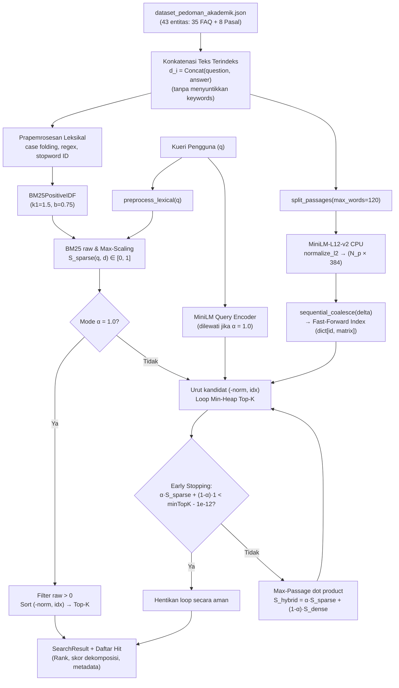

# Dokumentasi Teknis & Metodologi — Sistem Temu Kembali FAQ Akademik Hybrid Fast-Forward IR

Dokumen ini merupakan panduan teknis, ilmiah, dan operasional lengkap untuk repositori **`tki-hybrid-fastforward-faq-ir`** (Kelompok 8 — Mata Kuliah Temu Kembali Informasi, Program Studi Teknik Informatika, Fakultas Ilmu Komputer, Universitas Sriwijaya).

---

## Daftar Isi

1. [Gambaran Umum & Tujuan Sistem](#1-gambaran-umum--tujuan-sistem)
2. [Arsitektur Pipeline & Alur Data](#2-arsitektur-pipeline--alur-data)
3. [Referensi API Modul Inti (`faq_core.py`)](#3-referensi-api-modul-inti-faq_corepy)
4. [Spesifikasi Dataset & Sinkronisasi Pedoman UNSRI 2026/2027](#4-spesifikasi-dataset--sinkronisasi-pedoman-unsri-20262027)
5. [Protokol Evaluasi & Metrik (`evaluate.py`)](#5-protokol-evaluasi--metrik-evaluatepy)
6. [Panduan Antarmuka Streamlit (`faq_pipeline.py`)](#6-panduan-antarmuka-streamlit-faq_pipelinepy)
7. [Pengujian Otomatis & Jaminan Mutu (`test_pipeline.py`)](#7-pengujian-otomatis--jaminan-mutu-test_pipelinepy)
8. [Ringkasan Hasil Empiris & Analisis Efisiensi](#8-ringkasan-hasil-empiris--analisis-efisiensi)
9. [Audit Perubahan dari Draf Awal (`real.pdf`)](#9-audit-perubahan-dari-draf-awal-realpdf)
10. [Catatan Keterbatasan & Panduan Tanya-Jawab Presentasi](#10-catatan-keterbatasan--panduan-tanya-jawab-presentasi)

---

## 1. Gambaran Umum & Tujuan Sistem

Sistem ini dirancang untuk menyelesaikan masalah **ketidaksesuaian kosakata (*vocabulary mismatch*)** ketika mahasiswa mencari informasi aturan akademik menggunakan bahasa percakapan sehari-hari, misalnya:

- Mengetik *"KTM saya patah dan hilang"* padahal dokumen resmi UNSRI 2026/2027 menyebutnya **Kartu Pengenal Mahasiswa (KPM)**.
- Mengetik *"sertifikat nilai bahasa inggris buat lulus"* untuk **USEPT** (*Universitas Sriwijaya English Proficiency Test*).
- Mengetik *"tidak ingat kode akses masuk sistem"* untuk pemulihan akun **SIAKAD**.
- Mengetik *"mau istirahat kuliah sementara"* untuk **Stop Out (SO)**.

Pendekatan yang digunakan menggabungkan:
1. **Jalur Sparse (Leksikal):** Okapi BM25 dengan IDF positif untuk menjaga presisi terhadap akronim dan terminologi administratif (KRS, KPRS, KPM, USEPT, SKPI, MSIB, SATGAS PPKPT).
2. **Jalur Dense (Semantik):** *Fast-Forward Index* berbasis embedding prakomputasi dari model multilingual pralatih `sentence-transformers/paraphrase-multilingual-MiniLM-L12-v2` (dimensi 384) yang berjalan 100% di **CPU tanpa GPU**.
3. **Fusi & Optimasi:** Interpolasi konveks linier berbobot $\alpha$, dukungan *multi-passage* dengan *Sequential Coalescing*, agregasi *Max-Passage*, serta *Safe Early Stopping* berbasis min-heap Top-K.

---

## 2. Arsitektur Pipeline & Alur Data



### Formulasi Matematis Inti

| Komponen | Persamaan | Keterangan |
|---|---|---|
| **IDF Positif** | $\text{IDF}(t) = \ln\!\left(1 + \frac{N - \text{df}(t) + 0{,}5}{\text{df}(t) + 0{,}5}\right)$ | Selalu positif untuk semua term; independen dari *epsilon-floor* `rank_bm25` |
| **BM25 Mentah** | $\text{BM25}(q, d) = \sum_{t \in T(q)} \text{IDF}(t) \cdot \frac{\text{TF}(t,d)(k_1 + 1)}{\text{TF}(t,d) + k_1(1 - b + b\frac{\|d\|}{\text{avgdl}})}$ | $k_1 = 1{,}5$, $b = 0{,}75$ |
| **Normalisasi Sparse** | $S_{\text{sparse}}(q, d) = \frac{\text{BM25}(q, d)}{\max_j \text{BM25}(q, d_j)}$ (atau $0$ bila maks $= 0$) | Memetakan skor BM25 ke rentang $[0, 1]$ |
| **Sequential Coalescing** | $\text{dist}(v, c) = 1 - \cos(v, c) < \delta$ | Menggabungkan passage bersebelahan dalam dokumen yang sama lalu re-normalisasi L2 |
| **Skor Dense Max-Passage** | $S_{\text{dense}}(q, d) = \max_{p \in d} (v_q \cdot v_p)$ | Vektor ternormalisasi L2 sehingga dot product $=$ cosine similarity |
| **Interpolasi Hibrida** | $S_{\text{hybrid}}(q, d) = \alpha \cdot S_{\text{sparse}}(q, d) + (1 - \alpha) \cdot S_{\text{dense}}(q, d)$ | $\alpha \in [0, 1]$ |
| **Safe Early Stopping** | $\text{UB}(i) = \alpha \cdot S_{\text{sparse}}(q, d_i) + (1 - \alpha) \times 1 < \text{minTopK} - 10^{-12}$ | Batas atas kosinus global $1{,}0$; menjamin Top-K eksak identik dengan *exhaustive* |

---

## 3. Referensi API Modul Inti (`faq_core.py`)

`faq_core.py` dirancang sepenuhnya **tanpa dependensi Streamlit** sehingga dapat diimpor oleh skrip evaluasi, pengujian otomatis, maupun layanan backend lain.

### Fungsi Utilitas
- **`preprocess_lexical(text: str, *, negation_safe: bool = False) -> list[str]`**
  Melakukan *case folding*, penghapusan tanda baca (`[^\w\s]`), *whitespace tokenization*, dan penyaringan stopword Bahasa Indonesia (`STOPWORDS_DEFAULT`). Jika `negation_safe=True`, kata `"tidak"` dipertahankan.
- **`normalize_l2(v: np.ndarray) -> np.ndarray`**
  Normalisasi L2 per baris (`float32`), memvalidasi tidak ada `NaN`/`Inf` atau vektor bernorma nol (`<= 1e-12`).
- **`split_passages(text: str, max_words: int = 120) -> list[str]`**
  Memecah teks dokumen menjadi segmen non-overlapping maksimum `max_words` kata.
- **`sequential_coalesce(vectors: np.ndarray, delta: float) -> np.ndarray`**
  Menggabungkan vektor passage berurutan dalam satu dokumen jika jarak kosinus ke centroid aktif `< delta`, lalu menormalisasi L2 centroid akhir. Validasi: `0 <= delta < 1` dan `vectors.ndim == 2`.

### Kelas Utama
- **`BM25PositiveIDF(tokenized_corpus, k1=1.5, b=0.75)`**
  - Atribut: `corpus_size`, `doc_len`, `avgdl`, `idf`.
  - Metode: `get_scores(query_tokens: list[str]) -> np.ndarray`.
- **`HybridFAQ(corpus, encoder, *, delta=0.035, max_passage_words=120, negation_safe=False, precomputed_passages_embeddings=None)`**
  - Membangun indeks BM25 dan Fast-Forward secara offline (hanya menggabungkan `question + answer` tanpa menyuntikkan `keywords`).
  - `rebuild_coalesced_index(*, delta: float)`: membangun ulang Fast-Forward Index untuk nilai `delta` baru tanpa melakukan *re-encoding*.
  - Properti: `compression_ratio` (`1 - coalesced_count / raw_passage_count`), `raw_passage_count`, `coalesced_count`, `multi_passage_docs`, `dim`.
  - `search(query, *, alpha=0.5, top_k=5, early_stopping=True, precomputed_query_vec=None) -> SearchResult`.
- **Dataclass Luaran:**
  - `Hit`: `rank`, `idx`, `id`, `doc_type`, `domain`, `title`, `question`, `answer`, `keywords`, `source_status`, `source_reference`, `raw_bm25`, `norm_bm25`, `dense`, `hybrid`.
  - `SearchResult`: `query`, `tokens`, `alpha`, `hits`, `evaluated_dense`, `total_documents`, `stopped_early`, `time_query_encoder_ms`, `time_total_core_ms`, `zero_lexical_match`.

### Contoh Penggunaan Programatik

```python
import json
from pathlib import Path
from sentence_transformers import SentenceTransformer
from faq_core import HybridFAQ, MODEL_NAME

corpus = json.loads(Path("dataset_pedoman_akademik.json").read_text(encoding="utf-8"))
encoder = SentenceTransformer(MODEL_NAME, device="cpu")
engine = HybridFAQ(corpus, encoder, delta=0.035, max_passage_words=120)

res = engine.search("KTM saya patah dan hilang bagaimana urus gantinya", alpha=0.1, top_k=5)
for h in res.hits:
    print(f"#{h.rank} [{h.id}] {h.title} | hybrid={h.hybrid:.4f} (bm25={h.norm_bm25:.3f}, dense={h.dense:.3f})")
```

---

## 4. Spesifikasi Dataset & Sinkronisasi Pedoman UNSRI 2026/2027

### Skema Data (`dataset_pedoman_akademik.json` & `.csv`)
Total **43 entitas** (**35 FAQ** + **8 Pasal Pedoman**) lintas **14 domain**, rata-rata 49,6 kata (42,28 token bersih) per dokumen.

| Field | Tipe | Deskripsi |
|---|---|---|
| `id` | `str` | Pengenal unik (`REG_001..006`, `KEU_001..005`, `ADM_001..004`, `CUTI_001..004`, `TIK_001..003`, `AKD_001..004`, `MBKM_001..003`, `TA_001..004`, `BEA_001..002`, `PEDOMAN_BAB*`) |
| `domain` / `category` | `str` | Kelompok layanan/bab |
| `type` | `str` | `"faq"` atau `"passage"` |
| `title` | `str` | Judul ringkas entri |
| `question` | `str` | Pertanyaan kanonik (diindeks bersama `answer`) |
| `answer` | `str` | Jawaban ringkas 37–72 kata (diindeks bersama `question`) |
| `keywords` | `list[str]` | Tag tampilan UI saja (**tidak** dimasukkan ke indeks agar tidak terjadi *keyword leakage*) |
| `source_status` | `str` | `"terverifikasi_pedoman_unsri_2026_2027"` (**32 entri**) atau `"kurasi_operasional_unit"` (**11 entri**) |
| `source_reference` | `str` | Nomor Sub-bab & halaman resmi Pedoman UNSRI 2026/2027 atau catatan unit operasional terkait |

### Daftar Koreksi Faktual Utama Terhadap Pedoman UNSRI 2026/2027
1. **`ADM_001` (KPM):** Memakai istilah resmi **Kartu Pengenal Mahasiswa (KPM)** (Sub-bab 6.1.3 & Lampiran 5), bukan KTM.
2. **`ADM_004` vs `PEDOMAN_BAB4_P3` (SKPI):** Memisahkan tegas **Surat Keterangan Pengganti Ijazah/Transkrip Hilang** (Sub-bab 6.2.2, Lampiran 15) dari **SKPI** (*Surat Keterangan Pendamping Ijazah*, Sub-bab 5.5).
3. **`AKD_001` (Kehadiran):** Minimal kehadiran perkuliahan **85%** (Sub-bab 3.2.2, hal. 40), bukan 80%.
4. **`CUTI_001` & `CUTI_002` (Stop Out / SO):** Maksimum **1 semester** untuk D3/S1/S2, syarat minimal 50% SKS, batas pengajuan minggu ke-3, penerima KIP-K/beasiswa penuh tidak boleh SO, dan **masa SO diperhitungkan ke dalam masa studi** (Sub-bab 3.4.1, 3.9, 6.1.4).
5. **`TA_003` (USEPT):** Memakai istilah resmi **USEPT** (Sub-bab 3.12.1 & 4.2.10), bukan SULIET.
6. **`PEDOMAN_BAB5_P1..P2` (Drop Out S1):** Evaluasi akhir tahun ke-2 minimal **52 SKS** (bukan 40 SKS) & IPK $\ge 2{,}00$; masa studi maks 14 semester; tidak bayar UKT tanpa SO masuk kriteria putus studi (Sub-bab 3.8.1).
7. **`PEDOMAN_BAB7_P1..P2`:** Pelaporan **SATGAS PPKPT** (Sub-bab 4.4) dan syarat **Cumlaude** S1: IPK 3,51–4,00, maks 8 semester, tanpa nilai C, nilai skripsi A, tidak mengulang, bukan pindahan (Sub-bab 3.12.2 Tabel 3.9).

---

## 5. Protokol Evaluasi & Metrik (`evaluate.py`)

### Pemisahan Kueri (`queries_eval.json`)
Total **50 kueri** berbahasa Indonesia yang dipisah secara *disjoint* (tanpa tumpang tindih ID maupun teks kueri):
- **Dev Set (`20 kueri`, `d01..d20`):** Digunakan secara eksklusif untuk penyetelan hiperparameter $\alpha \in \{0{,}0; 0{,}1; \dots; 1{,}0\}$.
- **Test Set (`30 kueri`, `t01..t30`):** Dikunci untuk evaluasi final dalam 4 kategori:
  - `akronim_eksak` (`n = 7`)
  - `parafrasa_sinonim` (`n = 10`)
  - `prosedur_administrasi` (`n = 6`)
  - `aturan_pedoman` (`n = 7`)
- **Graded Relevance:** `2` (dokumen target utama), `1` (dokumen pendukung langsung), `0` (tidak relevan).

### Definisi Metrik
- **Recall@k:** Proporsi dokumen relevan yang masuk ke Top-k.
- **MRR@k:** Rata-rata $1/\text{rank}$ dokumen relevan pertama dalam Top-k ($0$ jika tidak ditemukan).
- **MAP@k:** Rata-rata *Average Precision* per kueri dengan penyebut standar $\min(k, |\text{relevan}|)$.
- **nDCG@k:** $\text{DCG}@k / \text{IDCG}@k$ dengan gain $2^{\text{rel}} - 1$ dan diskon $\log_2(\text{rank} + 1)$.

### Argumen CLI `evaluate.py`

```powershell
python evaluate.py --top-k 5 --delta 0.035 --warmup 10 --repeats 8 --out hasil_evaluasi
```

Berkas luaran yang dihasilkan di `hasil_evaluasi/`:
- `dev_sweep_alpha.csv`: metrik & penghematan lookup pada seluruh $\alpha$ di dev set.
- `test_ringkasan.csv`: perbandingan 6 konfigurasi model pada test set (`k=5` dan `k=3`).
- `test_per_kategori.csv`: rincian Recall@5, MRR@5, dan nDCG@5 per kategori kueri.
- `test_per_kueri.csv`: jejak ranking dan jumlah lookup setiap kueri test.
- `metadata.json`: timestamp UTC, versi Python/PyTorch/SentenceTransformers/NumPy, spesifikasi CPU, jumlah thread, jumlah selisih early stopping vs exhaustive, dan statistik latensi `p50/p95`.

---

## 6. Panduan Antarmuka Streamlit (`faq_pipeline.py`)

Jalankan perintah berikut dari direktori `draft_revisi2_faq43/`:

```powershell
streamlit run faq_pipeline.py
```

Buka **`http://localhost:8501`** di browser. Komponen antarmuka meliputi:
1. **Sidebar Parameter:**
   - Slider **$\alpha$** (`0.00` – `1.00`, default `0.50`, langkah `0.05`) beserta indikator mode aktif (*Pure Dense*, *Hybrid*, *Pure Sparse BM25*).
   - Slider **Top-K** (`1` – `10`, default `5`).
   - Checkbox **Safe Early Stopping** (`cosine ≤ 1`).
   - Checkbox **Mode Negation-Safe** (mempertahankan kata `"tidak"` pada BM25).
2. **Preset Kueri & Kotak Input:** 8 preset cepat yang mendemonstrasikan *vocabulary mismatch* nyata UNSRI (KPM, USEPT, SATGAS PPKPT, SIAKAD, diskon UKT skripsi, ujian susulan, sanksi joki, Cumlaude).
3. **Kartu Jawaban Peringkat #1:** Menampilkan ID, judul, badge status sumber (`📘 Terverifikasi Pedoman UNSRI 2026/2027` atau `💬 FAQ Operasional Terkurasi`), domain, pertanyaan kanonik, jawaban lengkap, rujukan resmi sub-bab/halaman, dan tag kata kunci.
4. **Panel Explainable IR:** 4 metrik KPI (`Skor Hybrid`, `BM25 Norm / Dense`, `Dense Look-ups`, `Latensi Core CPU`), tabel dekomposisi skor Top-K, expander rincian jawaban peringkat `#2..#K`, serta daftar lengkap 43 entitas saat input kosong.

---

## 7. Pengujian Otomatis & Jaminan Mutu (`test_pipeline.py`)

Jalankan seluruh suite pengujian:

```powershell
pytest -q
```

Total **20 kasus uji** (`20 passed in 0.33s` terekam di `hasil_pytest.txt`), mencakup:
1. **Konsistensi dataset & regresi faktual UNSRI 2026/2027 (`test_dataset_json_csv_and_factual_consistency`):** memastikan 43 entri JSON & CSV identik, `ADM_001` memuat KPM, `ADM_004` dibedakan dari SKPI, `AKD_001` memuat 85%, `CUTI_002` memuat 1 semester & diperhitungkan masa studi, `TA_003` memuat USEPT, `PEDOMAN_BAB5_P1` memuat 52 SKS, `PEDOMAN_BAB4_P3` memuat Pendamping Ijazah, dan 0 rujukan fiktif Bab VII.
2. **Integritas split dev/test (`test_queries_dev_test_disjoint_and_valid`):** memastikan 20 dev & 30 test saling lepas dan seluruh target ada di korpus.
3. **Prapemrosesan & BM25 positif (`test_preprocessing_and_bm25_positive_idf`):** uji `negation_safe`, semua IDF $> 0$, dan nol overlap target `TIK_001` pada kueri parafrasa login.
4. **Sequential Coalescing & Multi-Passage (`test_coalesce_and_split_passages`):** uji penggabungan vektor berdekatan dan pemecahan 250 kata menjadi 3 passage.
5. **Invariant Safe Early Stopping (`test_exact_early_stopping_invariant`):** 15 kombinasi terparametrisasi (`alpha ∈ {0.0, 0.2, 0.5, 0.8, 0.95}` × `k ∈ {1, 3, 5}`) membuktikan keluaran Top-K dan skor hybrid identik hingga toleransi $10^{-7}$ terhadap pencarian *exhaustive*.
6. **No-match BM25 & Metrik IR (`test_no_match_and_metrics`):** memastikan BM25 murni mengembalikan daftar kosong bila tanpa kecocokan, serta memverifikasi hitungan tangan Recall@k, MRR@k, AP@k, dan `evaluate_config`.

---

## 8. Ringkasan Hasil Empiris & Analisis Efisiensi

Lingkungan eksekusi terverifikasi (`metadata.json`):
- **OS & CPU:** `Windows-11-10.0.26300-SP0`, `AMD64 Family 25 Model 33 Stepping 2, AuthenticAMD`, `4 thread` PyTorch CPU.
- **Software:** Python `3.13.2`, PyTorch `2.8.0+cpu`, `sentence-transformers 5.7.0`, NumPy `2.2.2`.
- **Encoder:** `sentence-transformers/paraphrase-multilingual-MiniLM-L12-v2` (dimensi 384).

### Performa Keseluruhan pada Unseen Test Set (`n = 30`)

| Konfigurasi Model | Hemat Lookup | Recall@5 | MRR@5 | MAP@5 | nDCG@5 | nDCG@3 |
|---|---:|---:|---:|---:|---:|---:|
| BM25 Murni (`α = 1,0`) | N/A | 0,9167 | 0,8778 | 0,8639 | 0,8873 | 0,8834 |
| Dense Murni (`α = 0,0`) | 0,00% | 0,9000 | 0,8500 | 0,8222 | 0,8544 | 0,8544 |
| Hybrid Default (`α = 0,5`, ES) | 3,33% | 0,9500 | 0,8861 | 0,8750 | 0,9023 | 0,8880 |
| Hybrid Exhaustive (`α* = 0,1`) | 0,00% | 0,9500 | 0,9278 | 0,9028 | 0,9301 | 0,9261 |
| **Hybrid Safe Early Stop (`α* = 0,1`)** | **0,00%** | **0,9500** | **0,9278** | **0,9028** | **0,9301** | **0,9261** |

### Performa Per Kategori pada Unseen Test Set (`α* = 0,1`)

| Kategori Kueri | BM25 Rec@5 | Dense Rec@5 | Hybrid Rec@5 | BM25 nDCG@5 | Dense nDCG@5 | Hybrid nDCG@5 |
|---|---:|---:|---:|---:|---:|---:|
| Akronim & Istilah Eksak (`n = 7`) | 1,0000 | 1,0000 | 1,0000 | 0,9921 | 0,9948 | **1,0000** |
| Aturan & Pasal Pedoman (`n = 7`) | 1,0000 | 0,9286 | 1,0000 | 1,0000 | 0,8871 | 0,9921 |
| **Parafrasa & Sinonim (`n = 10`)** | 0,7500 | 0,7500 | **0,8500** | 0,6675 | 0,6457 | **0,7957** |
| Prosedur Administrasi (`n = 6`) | 1,0000 | 1,0000 | 1,0000 | 1,0000 | 1,0000 | 1,0000 |

### Latensi CPU Lokal (240 Eksekusi Kueri Test Pasca 10× Warm-Up)

| Mode Eksekusi (`N = 43`) | Core p50 (ms) | Core p95 (ms) | Encoder p50 (ms) | Ranking Saja p50 (ms) |
|---|---:|---:|---:|---:|
| BM25 Murni (`α = 1,0`) | 0,14 | 0,19 | 0,00 | 0,14 |
| Hybrid Exhaustive (`α* = 0,1`) | 16,74 | 18,72 | 15,91 | 0,83 |
| Hybrid Safe Early Stop (`α* = 0,1`) | 16,80 | 18,66 | 15,98 | 0,83 |

---

## 9. Audit Perubahan dari Draf Awal (`real.pdf`)

| Aspek | Draf Awal (`real.pdf`) | Versi Terverifikasi (`draft_revisi2_faq43`) |
|---|---|---|
| Rumus BM25 | `rank_bm25.BM25Okapi` tidak cocok dengan Pers. (5) | `BM25PositiveIDF` mandiri, 100% cocok dengan rumus |
| No-match & tie-break | Skor 0 tetap di-rank; `np.argsort` non-deterministik | BM25 murni no-match kosong; tie-break deterministik berdasarkan indeks |
| Korpus | 5 FAQ buatan diklaim resmi | 43 entitas: 32 terverifikasi Pedoman UNSRI 2026/2027 + 11 kurasi operasional |
| Evaluasi & split | 4 kueri tanpa dev/test; kesalahan hitung Tabel 9 (`α=0,2` ditulis 0,8750, aslinya 0,8333) | 50 kueri (20 dev / 30 test), otomatis via `evaluate.py`, Hybrid (`α*=0,1`) unggul nyata |
| Sequential Coalescing | Diklaim hemat 75%, tidak ada di kode | Diimplementasikan & diuji unit; jujur dilaporkan 0% pada FAQ pendek |
| Early Stopping | Diklaim hemat 74%, tidak ada di kode, bound heuristik tidak aman | Safe bound `cosine ≤ 1`; 0 selisih vs exhaustive; hemat lookup hingga 76,40% di dev (`α=0,9`) |
| InfoNCE & Encoder L=0 | Diklaim di metode tanpa dilakukan | Dicabut; jujur memakai model pretrained MiniLM-L12-v2 di CPU |
| Latensi CPU | Diklaim `< 9 ms` tanpa benchmark | Terukur jujur (240 kueri): core `p50 = 16,80 ms` |
| QA & Reproduksibilitas | 0 unit test, 1 file monolitik | Modular + 20 unit test lulus + CSV/JSON/grafik 300 DPI |

---

## 10. Catatan Keterbatasan & Panduan Tanya-Jawab Presentasi

### Keterbatasan yang Dinyatakan Terbuka
1. **Status 11 entri operasional:** 11 entri teknis TI/keuangan belum termuat rinci di Buku Pedoman UNSRI 2026/2027 sehingga diberi label `kurasi_operasional_unit` untuk dikonfirmasi ke unit terkait.
2. **Sequential Coalescing = 0% pada 43 FAQ ringkas:** Karena seluruh entri berukuran 37–72 kata (< 120 kata), setiap dokumen hanya 1 passage.
3. **Anotator & Baseline Lanjutan:** 50 kueri disusun tim peneliti (belum multi-anotator dengan Cohen's κ) dan belum dibandingkan dengan baseline Cross-Encoder.
4. **Interpretasi Skor:** Skor hybrid adalah skor peringkat relatif, bukan probabilitas kebenaran jawaban.

### Panduan Singkat Tanya-Jawab Saat Presentasi / Sidang
- **T: Mengapa rasio kompresi Sequential Coalescing 0% pada dataset ini?**
  *J:* Algoritma `sequential_coalesce` sudah diimplementasikan penuh di `faq_core.py` dan lulus uji otomatis di `test_pipeline.py`. Nilainya 0% pada 43 FAQ ini karena seluruh kartu jawaban sengaja dibuat ringkas (37–72 kata, di bawah ambang 120 kata) sehingga 1 dokumen = 1 passage. Kompresi akan otomatis aktif ketika sistem diisi dokumen panduan panjang multi-passage (> 120 kata).
- **T: Mengapa Safe Early Stopping tidak menghemat lookup pada `α* = 0,1`?**
  *J:* Karena batas atas aman memakai `α · S_sparse + (1 − α) × 1`. Saat `α = 0,1`, suku `(1 − α) = 0,9` sangat besar sehingga batas atas tetap tinggi demi menjamin **0 kesalahan peringkat** (*exact Top-K*). Ketika `α` dinaikkan (`0,6–0,9`), penghematan lookup naik signifikan hingga **76,40%** di dev set sambil tetap menjaga 0 selisih peringkat.
- **T: Mengapa latensi CPU ~16 ms, bukan < 9 ms?**
  *J:* Sekitar 95% waktu online (`~15,9 ms`) berasal dari inferensi *query encoder* MiniLM-L12-v2 pada CPU, sedangkan skoring BM25 + dot product + interpolasi pada 43 dokumen hanya **0,83 ms**. Angka ini diukur jujur pada 240 eksekusi pasca 10× warm-up dengan spesifikasi mesin tercatat di `metadata.json`.
- **T: Apa bukti konkret bahwa Hybrid lebih baik daripada BM25 atau Dense saja?**
  *J:* Pada 30 kueri test tak terlihat (khususnya 10 kueri parafrasa seperti *KTM hilang → KPM* atau *sertifikat bahasa Inggris → USEPT*), BM25 saja hanya meraih `nDCG@5 = 0,6675` dan Dense saja `0,6457`, sedangkan gabungan Hybrid (`α* = 0,1`) melonjak ke **`0,7957`** (dan keseluruhan test `nDCG@5 = 0,9301`).
