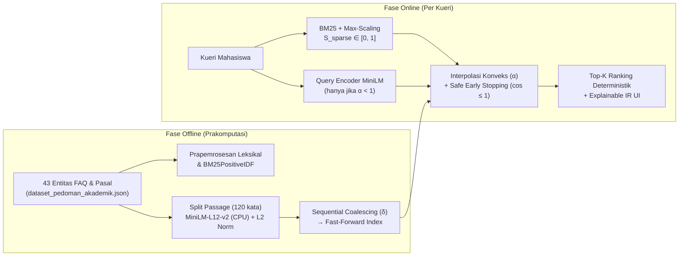
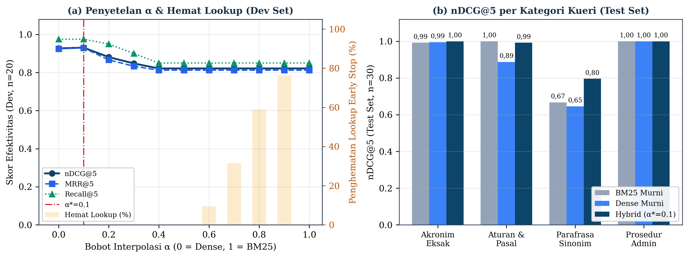

# 🎓 Hybrid Fast-Forward IR — Sistem Temu Kembali FAQ & Pedoman Akademik UNSRI

Implementasi terverifikasi, evaluasi reproduksibel, antarmuka _Explainable Information Retrieval_ (Streamlit), dan naskah ilmiah untuk sistem temu kembali **FAQ & Pedoman Akademik Perguruan Tinggi** berbasis **Okapi BM25 (IDF Positif)** dan **Fast-Forward Dense Index** (`paraphrase-multilingual-MiniLM-L12-v2` pada CPU).

>  **Naskah paper terverifikasi:** [Naskah_Paper.pdf](Naskah_Paper.pdf) | [Naskah_Paper.docx](Naskah_Paper.docx)

---

## Arsitektur Singkat

---

## Fitur Utama

- **BM25 IDF Positif Mandiri (`BM25PositiveIDF`):** Implementasi eksplisit $\text{IDF}(t) = \ln\!\left(1 + \frac{N - \text{df}(t) + 0{,}5}{\text{df}(t) + 0{,}5}\right)$ dengan $k_1 = 1{,}5, b = 0{,}75$ (bebas dari perbedaan _epsilon-floor_ `rank_bm25`).
- **Fast-Forward Multi-Passage & Sequential Coalescing:** Mendukung pemecahan passage (120 kata), penggabungan vektor passage berurutan dengan re-normalisasi centroid L2, serta agregasi _Max-Passage_ (`maxP`).
- **Safe Early Stopping (Eksak):** Menggunakan batas atas kosinus global `1.0` pada min-heap Top-K; **0 selisih peringkat** dibanding pencarian _exhaustive_ pada seluruh kueri uji.
- **Korpus Tersinkronisasi Pedoman UNSRI 2026/2027:** 43 entitas (**32 terverifikasi langsung** terhadap _Buku Pedoman Akademik & Kemahasiswaan UNSRI 2026/2027_ + **11 kurasi operasional unit terkait**), mencakup KPM, USEPT, SKPI, kehadiran 85%, evaluasi 52 SKS, Stop Out maks 1 semester, Cumlaude, dan SATGAS PPKPT.
- **Evaluasi Dev/Test Terpisah & Reproduksibel:** 50 kueri terpisah ketat (**20 dev** untuk penyetelan $\alpha$ / **30 test tak terlihat** dalam 4 kategori), benchmark latensi CPU `p50/p95`, dan **20/20 unit test lulus**.

---

## Hasil Evaluasi Empiris (CPU, MiniLM-L12-v2)

Hiperparameter dipilih murni pada **Dev Set (`n = 20`)**: **`α* = 0,1`** (`nDCG@5 = 0,9308`).

| Model (`N = 43`, Unseen Test `n = 30`)  | Hemat Lookup |   Recall@5 |      MRR@5 |      MAP@5 |     nDCG@5 | Parafrasa nDCG@5 (`n=10`) |
| --------------------------------------- | -----------: | ---------: | ---------: | ---------: | ---------: | ------------------------: |
| BM25 Murni (`α = 1,0`)                  |          N/A |     0,9167 |     0,8778 |     0,8639 |     0,8873 |                    0,6675 |
| Dense Murni (`α = 0,0`)                 |        0,00% |     0,9000 |     0,8500 |     0,8222 |     0,8544 |                    0,6457 |
| Hybrid Default (`α = 0,5`, ES)          |        3,33% |     0,9500 |     0,8861 |     0,8750 |     0,9023 |                         — |
| **Hybrid Safe Early Stop (`α* = 0,1`)** |    **0,00%** | **0,9500** | **0,9278** | **0,9028** | **0,9301** |                **0,7957** |

- **Early Stopping vs Exhaustive:** **0 selisih peringkat** pada seluruh 30 kueri test (penghematan lookup pada dev mencapai `31,40%` di `α = 0,7`, `58,95%` di `α = 0,8`, dan `76,40%` di `α = 0,9`).
- **Latensi CPU Lokal (240 eksekusi pasca 10× warm-up, 4 thread PyTorch):** core `p50 = 16,80 ms` (`p95 = 18,66 ms`, pemeringkatan saja `0,83 ms`); BM25 murni `0,14 ms`.
- **Sequential Coalescing:** `0,00%` pada 43 entri ringkas (37–72 kata, 1 passage/dokumen); modul siap aktif otomatis pada dokumen panjang multi-passage (> 120 kata).

---

## Struktur Berkas

| Berkas / Direktori                       | Deskripsi                                                                                                                  |
| ---------------------------------------- | -------------------------------------------------------------------------------------------------------------------------- |
| `faq_core.py`                            | Mesin IR inti tanpa dependensi Streamlit (BM25, Coalescing, MaxP, Safe Early Stopping)                                     |
| `faq_pipeline.py`                        | Antarmuka web Streamlit Explainable IR                                                                                     |
| `evaluate.py`                            | Skrip evaluasi dev/test, cek invariant early stopping, dan benchmark latensi CPU                                           |
| `test_pipeline.py`                       | 20 pengujian otomatis (matematis, invariant ranking, dan regresi faktual UNSRI)                                            |
| `dataset_pedoman_akademik.json` / `.csv` | 43 entitas FAQ & pasal pedoman (32 terverifikasi Pedoman UNSRI 2026/2027 + 11 operasional)                                 |
| `queries_eval.json`                      | 50 kueri uji mahasiswa terpisah (20 dev + 30 test) beranotasi relevansi bertingkat                                         |
| `hasil_evaluasi/`                        | Luaran CSV (`dev_sweep_alpha`, `test_ringkasan`, `test_per_kategori`, `test_per_kueri`), `metadata.json`, & grafik 300 DPI |
| `Naskah_Paper_FAQ43.pdf` / `.docx`       | Naskah ilmiah 4 halaman lengkap dengan grafik dan tabel terverifikasi                                                      |

---

